# ORBIT

**The Intelligent Work Operating System** — a phased, production-oriented SaaS build.

Phase 7 adds milestones, sprint lifecycle/boards, timeline/Gantt, task dependencies, workload planning and delivery history to the existing authorized project/task system. See [the Phase 7 verification report](docs/PHASE7_REPORT.md). Marketing sample content demonstrates the intended product. Realtime collaboration, files, analytics, AI and billing remain in later phases.

Source repository: [devanshchaudharyy/orbit](https://github.com/devanshchaudharyy/orbit) (private). Phases 0–7 are implemented and published. Windows Docker/WSL and restart acceptance remain deferred; fixture verification and remote Compose evidence are recorded separately in each phase report.

## Screenshots

Captured from the running application. Marketing product content is illustrative; account screenshots use synthetic test users connected to the real local API, MongoDB, and captured email.

### Marketing website


### Registration and personal account

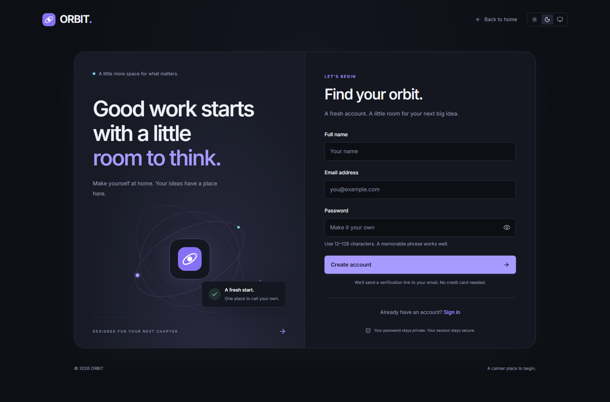

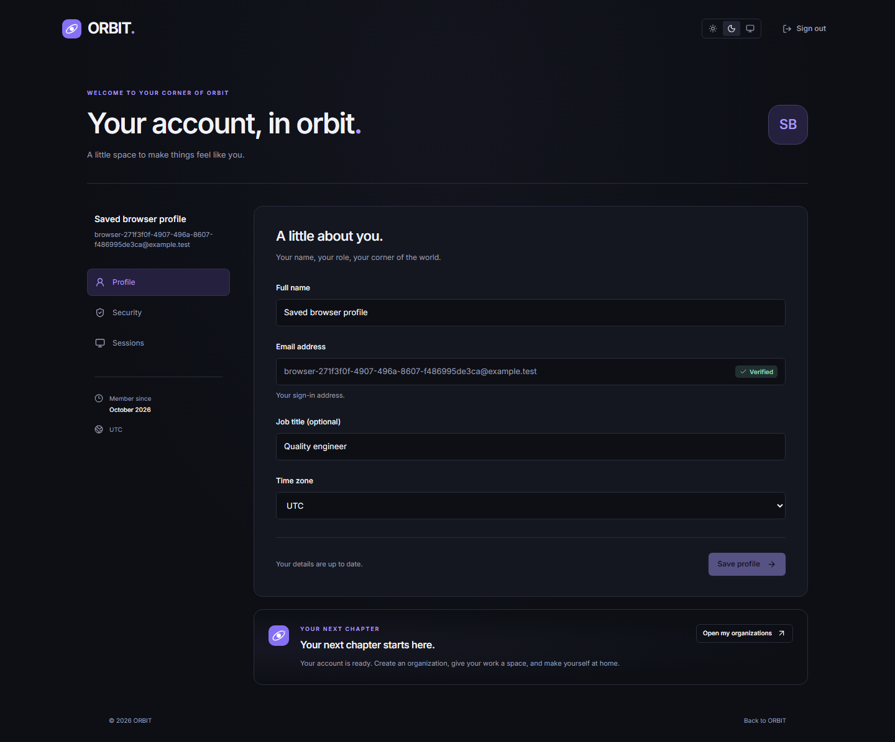

### Organizations and workspaces

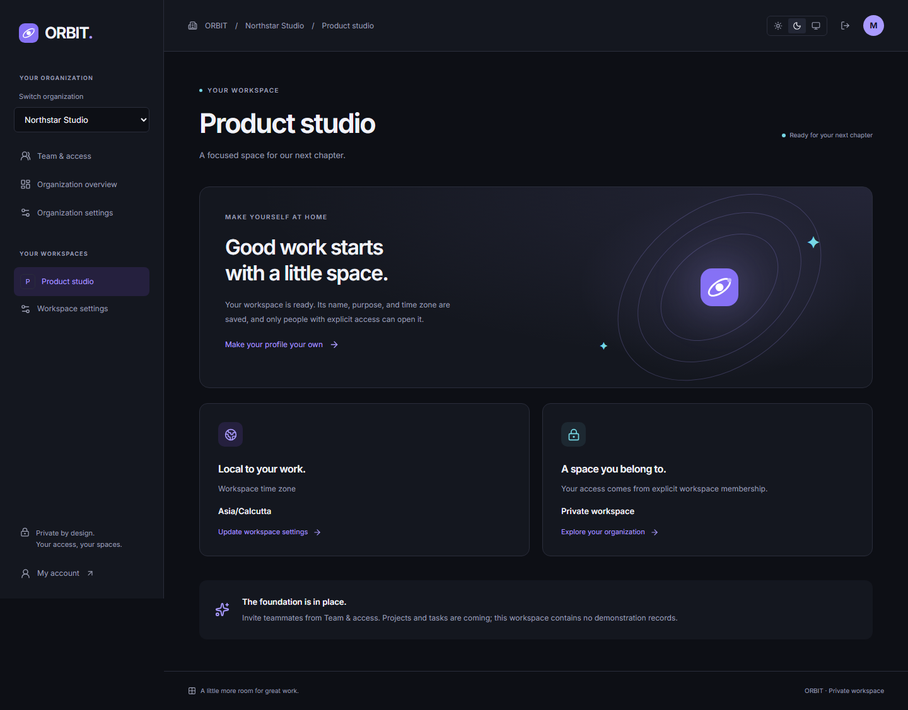

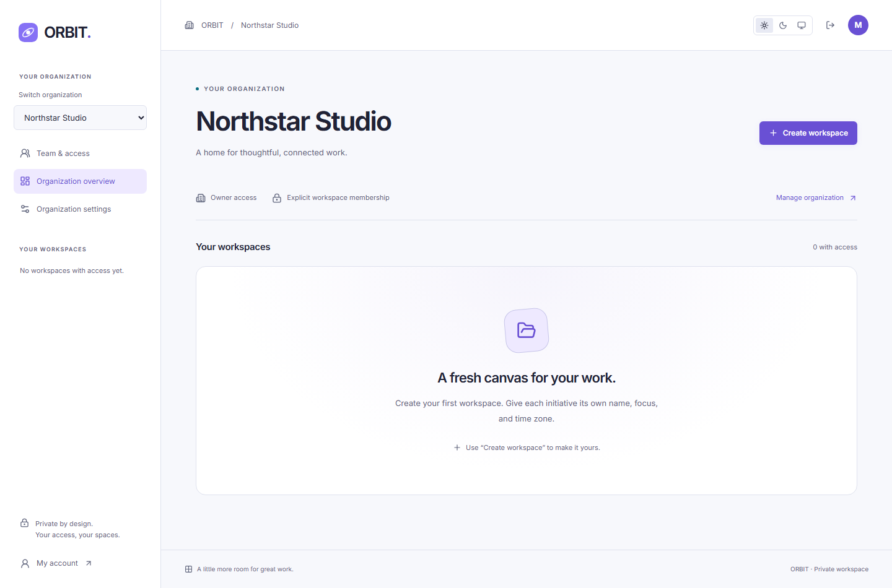

<details>
<summary>Mobile onboarding and the design system lab</summary>

<p>
  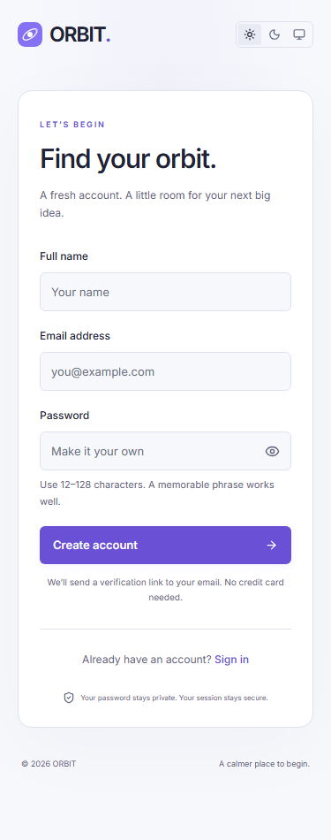
  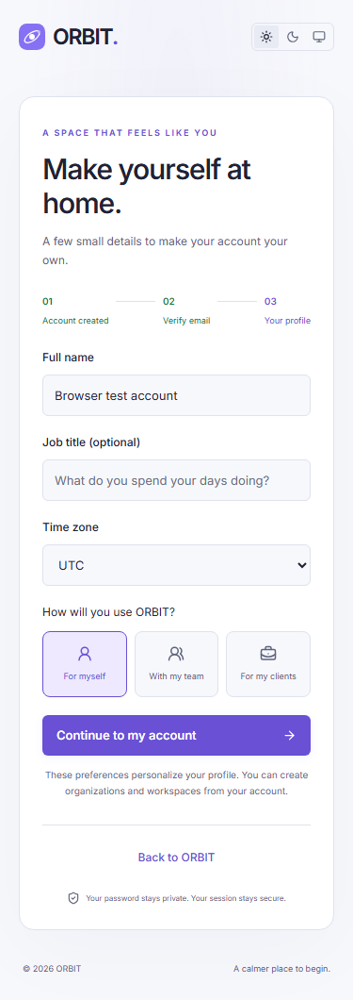
</p>

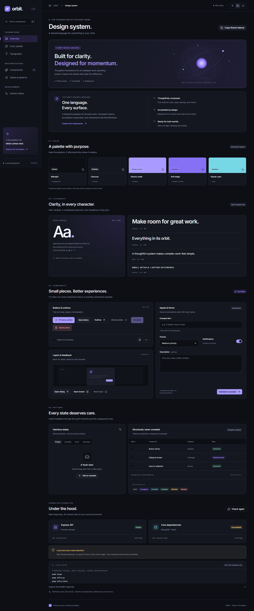

</details>

See [the screenshot gallery](docs/SCREENSHOTS.md) for all themes, viewport sizes, account states, and full-page marketing captures.

### Teams and permissions


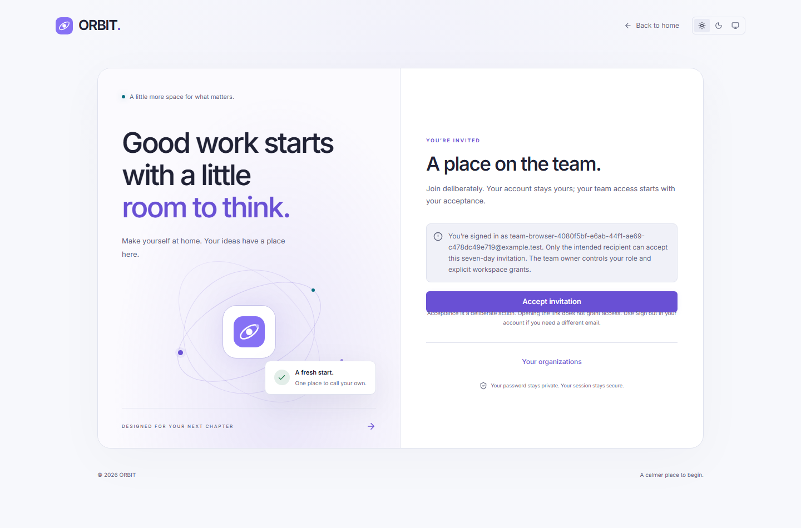

### Projects and tasks

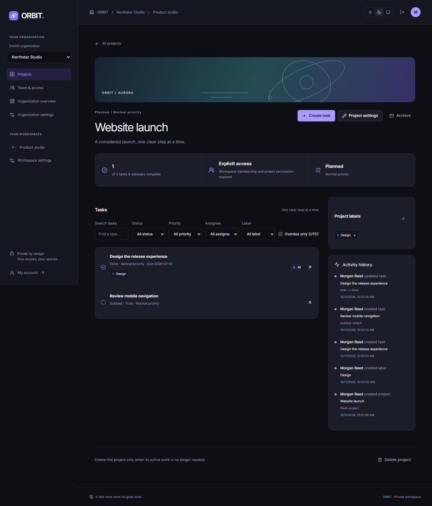

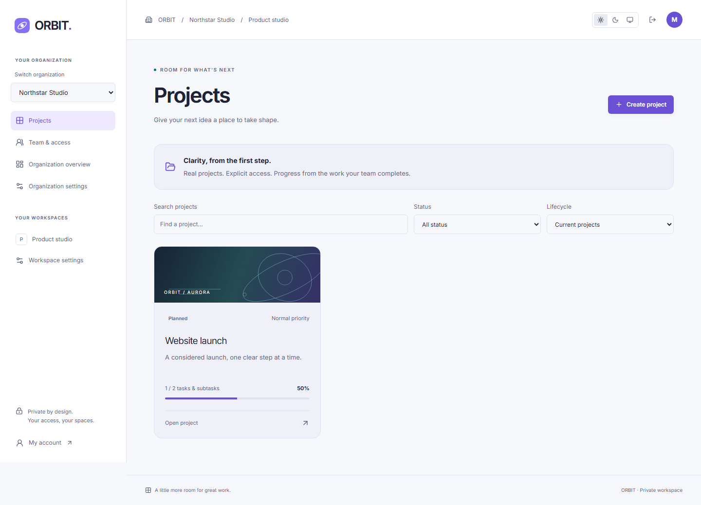

## Work views and preferences

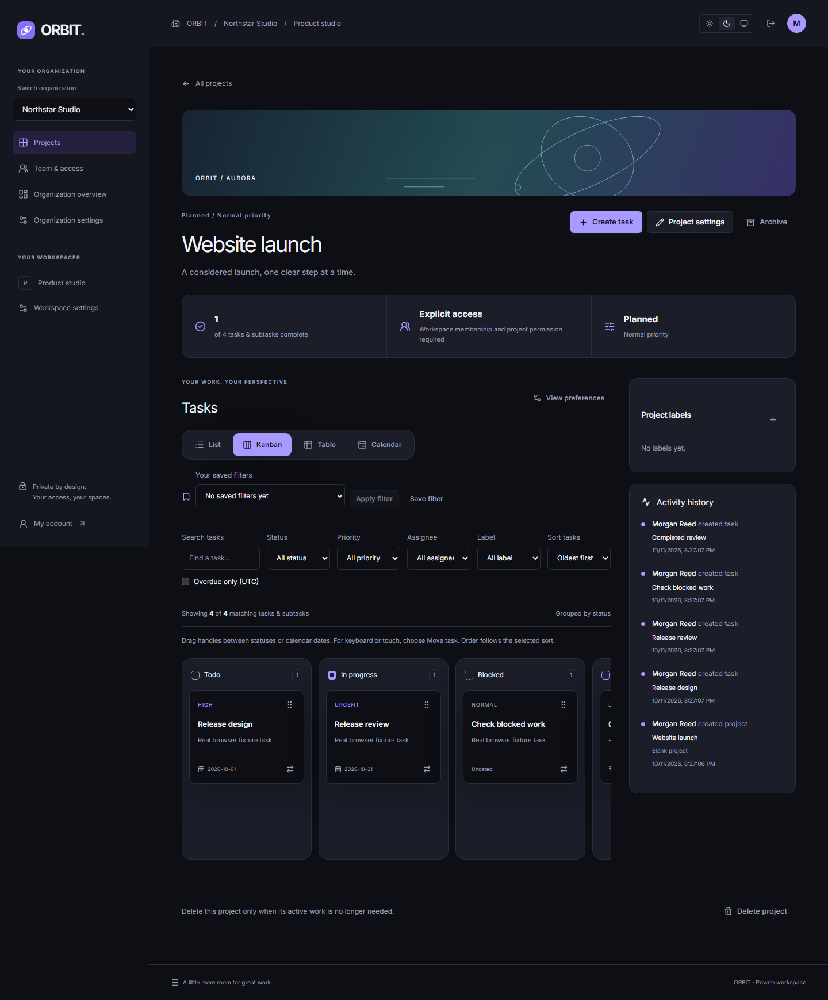

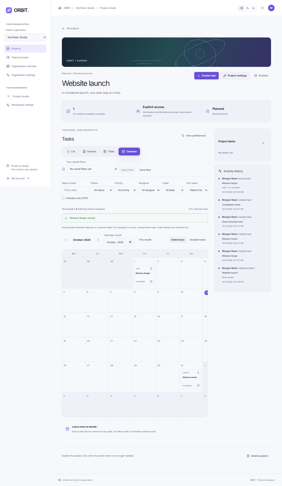

All views share current project permissions, filters, server sorting and bounded pages with truthful matching/loaded counts. Move tasks between statuses/dates using handles or keyboard-accessible dialogs. Save private named filters and persist personal view/density/week-start/column/subtask defaults across sessions. Calendar days use UTC; within-column order follows sorting.

## Phase 6 verification

Final local verification through Phase 6: **121 unit/component/API tests**, **116 real integration/transaction checks**, **55 browser scenarios**, **238 accessibility scans** with zero axe violations, and **12 production route/build checks** passed. These include 24 view integration checks, five view browser scenarios and 54 new theme/viewport/overlay scans. All final browser suites passed directly. Exact commands, screenshots and limits are recorded in [the Phase 6 report](docs/PHASE6_REPORT.md).

The isolated local fixture uses MongoDB **8.3.4** and Mailpit **1.27.10**. The [completed Phase 6 GitHub workflow](https://github.com/devanshchaudharyy/orbit/actions/runs/38150192862) independently passed pinned Compose infrastructure, the full integration/browser suites, and all checks/builds, with no flaky browser result reported. Local Docker/WSL setup and container-restart durability remain deferred; exact recovery commands and evidence are in the phase report.

## Delivery planning

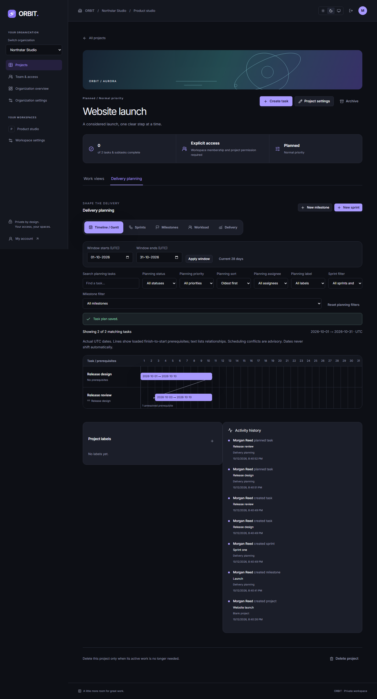

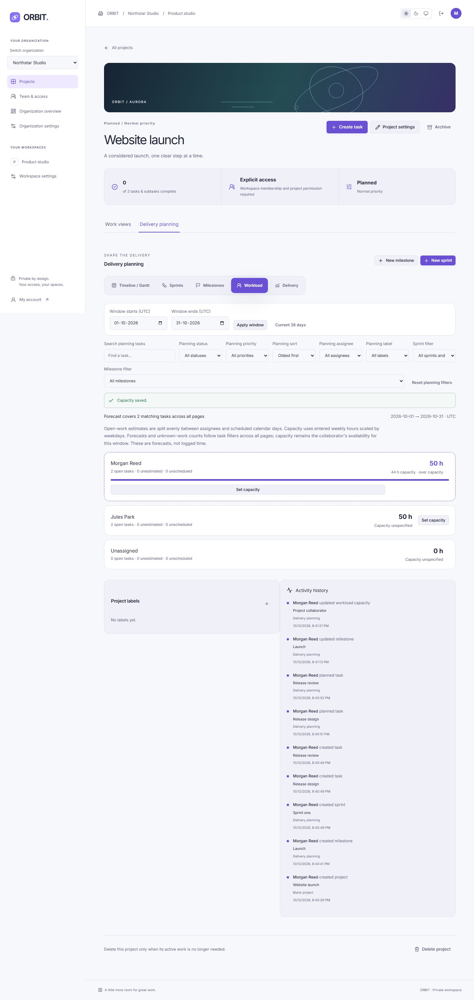

Open an authorized project and choose **Delivery planning**. Plan dates, entered effort, prerequisites and milestone/sprint assignments. Dependencies report blockers and date conflicts without silently rescheduling. Start one sprint, move tasks using handles or keyboard dialogs, then complete with explicit carryover and a frozen delivery snapshot. Milestones separate explicit delivery status from actual progress. Workload follows filters across all pages and distinguishes unknown effort, unscheduled work and unspecified capacity.

Managers/project owners manage milestones, sprints and capacity; current non-guest collaborators plan tasks. Guests read authorized planning and archives reject writes. All mutations check original versions and current membership transactionally. No test project is seeded into your account. [Phase 7 results and limitations](docs/PHASE7_REPORT.md), [66 planning screenshots](docs/SCREENSHOTS.md).

Phase 7 local verification passed **136 unit/component/API tests**, **148 real integration/transaction checks**, **61 browser scenarios**, **304 accessibility scans with zero violations**, and **12 production checks**, plus strict types, lint, formatting and builds. All final browser suites passed directly. The retained gallery contains **303 PNGs**. Exact commands, fixes, current publication/CI evidence and deferred Windows acceptance are in [the report](docs/PHASE7_REPORT.md).

## Start locally

Prerequisites: Node **24.18.0**, pnpm **11.25.0**, and Git. Docker Desktop with Linux containers is required for the infrastructure checks. The UI and health API run without Docker, with readiness reporting HTTP 503.

```powershell
pnpm install --frozen-lockfile
pnpm run setup
pnpm infra:up
pnpm dev
```

Open [the marketing website](http://127.0.0.1:5173/) or [the development design lab](http://127.0.0.1:5173/dev/design-system). The API listens on `127.0.0.1:4000`; Vite proxies `/api`. `pnpm setup` also resolves the local setup script with the pinned pnpm version; `pnpm run setup` is the explicit form.

If Docker is unavailable, omit `pnpm infra:up` to preview the website and component lab. Account operations require MongoDB and local email delivery; unavailable services produce explicit feedback.

For the isolated authentication preview, an already installed MongoDB executable can run a separate replica set while a checksum-verified, workspace-local Mailpit binary captures mail. This does not install Windows prerequisites or verify the Compose stack:

```powershell
pnpm auth:fixture prepare
pnpm auth:fixture start
```

Open [account registration](http://127.0.0.1:5174/auth/register) and [captured email](http://127.0.0.1:18025/). The fixture uses separate ports and `orbit_test_phase2`, retains its ignored local data, refuses occupied ports, and stops only the child processes it starts. See [testing instructions](docs/TESTING.md) for requirements and verification commands.

After registration, email verification, and personal onboarding, choose **Open my organizations** on the account page or visit [`/app`](http://127.0.0.1:5174/app). Create an organization, then its workspaces. No sample tenant data is seeded into your account.

## Repository layout

| Package                     | Responsibility                                                          |
| --------------------------- | ----------------------------------------------------------------------- |
| `apps/web`                  | React/Vite browser application and development-only lab                 |
| `apps/api`                  | Express API, configuration, middleware, infrastructure adapters         |
| `packages/ui`               | Source-owned shadcn/ui-style primitives built on Radix, semantic tokens |
| `packages/contracts`        | Shared Zod response schemas and TypeScript contracts                    |
| `packages/config`           | Shared strict TypeScript configuration                                  |
| `infra`, `scripts`, `tests` | Reproducible local services, tooling, browser verification              |

## Commands

| Command                                      | Purpose                                                                                  |
| -------------------------------------------- | ---------------------------------------------------------------------------------------- |
| `pnpm run setup`                             | Generate ignored local credentials and Garage configuration; preserve existing values    |
| `pnpm dev`                                   | Build contracts and start both applications                                              |
| `pnpm build`                                 | Build contracts/API and a lab-disabled production frontend                               |
| `pnpm typecheck`                             | Check every TypeScript package                                                           |
| `pnpm lint`                                  | ESLint with zero warnings allowed                                                        |
| `pnpm format:check`                          | Verify formatting without editing                                                        |
| `pnpm format`                                | Apply repository formatting                                                              |
| `pnpm test`                                  | Vitest, React Testing Library, and Supertest checks                                      |
| `pnpm test:e2e`                              | Chromium interactions, responsive checks, axe audits, screenshots                        |
| `pnpm infra:up` / `pnpm infra:down`          | Start/stop Compose services, retaining volumes                                           |
| `pnpm test:integration` / `pnpm infra:check` | Real database, Redis, S3, and captured-email checks                                      |
| `pnpm auth:fixture prepare` / `start`        | Prepare and start the isolated MongoDB/Mailpit authentication preview                    |
| `pnpm test:auth:integration`                 | Real account/session/token tests against the isolated fixture                            |
| `pnpm test:auth:transactions`                | Controlled real MongoDB credential races and registration rollback                       |
| `pnpm test:auth:e2e`                         | API-backed account browser flows, responsive and accessibility checks                    |
| `pnpm test:auth:compose`                     | Run auth verification against running Compose services in an isolated test database      |
| `pnpm test:tenants:integration`              | Real MongoDB tenant isolation, role/access, rollback, concurrency, and pagination checks |
| `pnpm test:tenants:e2e`                      | Real organization/workspace browser flows, switching, settings, keyboard, and axe checks |
| `pnpm test:teams:integration`                | Real MongoDB team roles, invitations, lifecycle, membership and transaction checks       |
| `pnpm test:teams:e2e`                        | Team permissions, invitation acceptance, keyboard, themes and responsive browser checks  |
| `pnpm test:projects:integration`             | Real MongoDB project/task permissions, transactions, filters, rollback and pagination    |
| `pnpm test:projects:e2e`                     | Real project/task CRUD, grants, conflicts, filters, lifecycle and accessibility checks   |
| `pnpm test:views:integration`                | Private preferences/filters, versioned task moves, UTC dates and sorted pagination       |
| `pnpm test:views:e2e`                        | List/Kanban/table/calendar, settings, moves and accessibility                            |
| `pnpm test:planning:integration`             | Real transactions, dependencies/cycles, sprints/carryover, capacity, bounds and access   |
| `pnpm test:planning:e2e`                     | Actual planning flows, conflicts, failures, keyboard, themes and responsive axe checks   |

Install the test browser with `pnpm exec playwright install chromium`. On Linux CI, use `--with-deps chromium`.

## Configuration and safety

`.env.example` describes the configuration; `pnpm run setup` creates `.env.local` and `infra/.local/garage.toml`. Both are ignored by Git. Generated secrets are never printed. Real payment, AI, OAuth, and production credentials are outside the current phases.

Local services use persistent named volumes and loopback-only ports. Infrastructure checks restrict themselves to local endpoints and the `orbit_test` database, use unique artifact IDs, and clean up their own records. They never drop a database or clear unrelated Redis/email data.

Production builds omit the lab route and lab JavaScript. For deliberate production-preview verification, set `VITE_ENABLE_DESIGN_LAB=true` for the build. This flag is not enabled by default.

## Documentation

- [Architecture](docs/ARCHITECTURE.md)
- [Database](docs/DATABASE.md)
- [API](docs/API.md)
- [Design system](docs/DESIGN_SYSTEM.md)
- [Screenshots](docs/SCREENSHOTS.md)
- [Phase progress](docs/PHASE_PROGRESS.md)
- [Phase 1 implementation and verification](docs/PHASE1_REPORT.md)
- [Phase 2 scope](docs/PHASE2_PLAN.md)
- [Phase 2 implementation and verification](docs/PHASE2_REPORT.md)
- [Phase 3 scope](docs/PHASE3_PLAN.md)
- [Phase 3 implementation and verification](docs/PHASE3_REPORT.md)
- [Phase 4 implementation and verification](docs/PHASE4_REPORT.md)
- [Phase 5 implementation and verification](docs/PHASE5_REPORT.md)
- [Phase 6 scope](docs/PHASE6_PLAN.md)
- [Phase 6 implementation and verification](docs/PHASE6_REPORT.md)
- [Phase 7 scope](docs/PHASE7_PLAN.md)
- [Phase 7 implementation and verification](docs/PHASE7_REPORT.md)
- [Testing and Windows setup](docs/TESTING.md)

Current execution results and remaining blockers are recorded in the phase progress document. Source code is hosted in the private repository linked above. The application has not been deployed.
