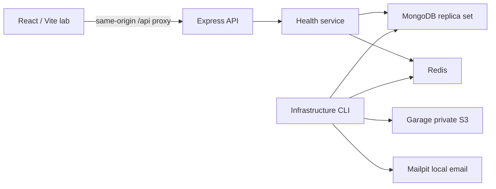

# Architecture

## Phase 11 AI and worker boundary

The persistent API exposes a lazy private project AI section with eight modes and actor-owned draft history. Contracts, bounded context repository, local provider adapter, generation/application service and HTTP routes remain separate. The AI SDK and provider execute only in Node. Loopback Ollama is optional and disabled by default; no cloud fallback or browser secret is introduced. Context uses current resource authority and excludes account credentials/file bytes/other projects. Dynamic mode/ID schemas and independent validation constrain output; plain-text rendering and explicit user review remain necessary for factual quality.

Generation reserves durable quotas and concurrency outside the model request. It stores a retry identity and snapshot hash, calls the model with a bounded deadline, then rechecks authority before committing a private result. Applying user-reviewed tasks/priorities uses the existing project repository with a shared transaction, preserving validation, activity and sprint observations. A current snapshot mismatch requires regeneration; no AI write tools run automatically.

`apps/api/src/worker.ts` is a separate persistent process for scheduled private draft workflows. MongoDB owns versioned due records; BullMQ carries only identifiers through Redis. Dispatch is bounded and repeat-safe; worker execution rechecks current account, manager grants, archive and workflow state. Successful heartbeat, provider configuration and actual generation success are distinct. Schedules cannot send messages or apply AI changes. Run `pnpm worker` separately and verify `pnpm worker:check`; no worker is silently enabled by starting the API. [Scope](PHASE11_PLAN.md), [results](PHASE11_REPORT.md).

## Phase 10 analytics boundary

The analytics module separates strict contracts, bounded repository snapshots, pure calculations/CSV serialization, service authorization and HTTP controllers. Report transactions reuse current tenant/project authority fences and read one consistent committed snapshot; dates do not pretend to reconstruct historical task state. Live project invalidations refresh scoped report query keys, while internal fence-only writes are ignored by change streams.

Project activity writes record changed active-sprint totals in the same transaction. Start captures actual initial remaining work; completion captures final totals before carryover and freezes completed estimate hours plus unknown-estimate counts. Observation failure rolls back the associated mutation. Unchanged totals do not create activity-shaped fake data. Earlier completed snapshots retain unavailable effort/history; there is no backfill, worker or fabricated baseline. Indexes support scoped observed-date and activity-date reads.

Recharts 3.10.1 and matching react-is 19.3.0 load only with the private analytics view. Charts support keyboard inspection, series/unit controls, equivalent data tables and reduced motion. [Recharts accessibility](https://github.com/recharts/recharts/wiki/Recharts-and-accessibility), [responsive chart API](https://recharts.github.io/en-US/api/ResponsiveContainer/). No external chart service, AI, billing or deployment. [Phase 10 scope](PHASE10_PLAN.md), [verification](PHASE10_REPORT.md).

## Phase 9 documents and storage

The documents module separates contracts, routes/controller, service, repository/models and private storage adapters. Current organization/workspace/project authority and transaction fences remain the permission boundary. Shared writers edit documents; authors/managers remove documents and manage file metadata. Guests and archives read only. Live streams include document/revision/file changes and emit content-free scoped invalidations; editor snapshots preserve original versions.

Disk/S3 implement put/get/remove. Development disk data is ignored and never exposed statically; production requires private S3. Generated keys, actual checksums, bounded formats/body sizes and authorization after storage I/O protect reads. Raw parsing runs only inside the explicitly authorized upload handler; other mutations retain JSON/Origin/CSRF rules. Durable pending intents coordinate object storage with MongoDB finalization. Logical removal precedes physical deletion; bounded reconciliation handles expired/deleted/orphaned objects without a worker.

Tiptap3.32.0 and PDF.js6.4.299 load lazily. Server validation enforces the supported editor JSON subset. PDF worker/fonts/maps/WASM are self-hosted generated build assets; canvas rendering disables XFA and does not integrate annotation/viewer scripting. Browser bytes always pass through current API authorization. Signature checks validate format, not malware scanning. No public sharing, CRDT editor, analytics, AI, billing or deployment. [Scope](PHASE9_PLAN.md), [verification](PHASE9_REPORT.md).

## Phase 5 project boundary

`projects` separates strict shared contracts, HTTP controller/routes, service entry points, Mongoose models and scoped persistence. The persistent Express service and cookie-session protections remain unchanged. No new dependency, provider, worker or deployment is introduced. The sections below retain earlier phase decisions as historical context.

Every request requires verified/onboarded identity, organization membership and explicit workspace membership. Workspace owners/admins/project managers manage projects; an eligible project owner manages their own project. Non-admin members require a project grant for task work; guests require a project grant and are read-only. Only workspace managers can transfer project ownership. No role bypasses workspace membership. Grant/assignment targets require current membership and project eligibility.

Transactional mutations fence current actor and target memberships plus project writeRevision. Versioned project/task editors reject stale writes; automatic database retries re-evaluate authorization. Templates, deletion cascades, label cleanup and activity recording commit atomically. Current parent relationships constrain queries; historical assignments/events never confer access. Bounded cursor APIs and literal typed filters support real progress and later views without fake analytics.

The browser lazily loads project directory/detail/task routes. TanStack Query keys include actor, organization, workspace, project and task; identity changes clear prior tenant data. URL filters survive refresh, while resource route keys reset local overlays/editor state. Form versions remain paired with loaded values across background refetches; conflicts require explicit reload. Radix dialogs/sheets handle contained/restored focus and scroll long forms. Errors and unavailable dependencies remain truthful.

Phase 6 implements richer views, drag-and-drop and preferences; Phase 7 implements delivery planning below. Realtime, files, analytics, AI and billing remain in later phases. Original vector project covers avoid introducing file storage before Phase 9. Activity is scoped project history, separate from the later global audit system.

## Implemented in Phase 0

The pnpm monorepo shares runtime Zod response contracts, source-owned React components, and strict TypeScript configuration. Workspace imports use `workspace:*` and explicit package exports. Contracts compile before API/web checks or development startup. The frontend is a client-rendered Vite application, not a server-rendered framework.

The API separates process startup from application construction. Configuration is validated once, logging is structured and redacted, HTTP middleware owns request IDs/error formatting, and health routes receive infrastructure dependencies through an interface. Production TypeScript compiles to Node ESM. Graceful shutdown stops HTTP acceptance and closes connections, with a five-second deadline.

TanStack Query owns server responses; Zustand owns appearance and command-palette visibility only. Forms use React Hook Form and Zod. The design lab is loaded lazily only when development or an explicit build flag enables it.

Liveness is independent of database availability. Readiness checks MongoDB and Redis concurrently, with bounded connection/command timeouts and deduplicated in-flight probes. HTTP responses disclose only aggregate health, not credentials, hostnames, or individual dependency errors.

## Phase 1 public website

`/` serves the lazy-loaded marketing page in development and production. `/dev/design-system` remains development-only unless `VITE_ENABLE_DESIGN_LAB=true` explicitly enables it. Unknown routes render an accessible recovery page linking home. Native hash links navigate to product, feature, pricing, and FAQ sections and support refresh.

Marketing interactions use local React state: sample Board/List views, a design filter, task details, a guided tour, billing-period comparison, and selected-plan information. Shared Radix dialogs own focus containment, with explicit restoration to each opening control. The theme control is shared with the lab. Marketing CSS scopes shared heading selectors to prevent route-to-route style conflicts. Motion respects the user's reduced-motion preference.

No marketing endpoint, waitlist, account registration, payment collection, or product persistence is introduced. Prices and included features are explicitly proposed previews. The current backend and health contracts remain unchanged; future feature descriptions are labeled as plans. This phase needs no new dependencies or services.

## Future module conventions

Future feature modules organize routes/controllers, services, persistence, validation, and tests within their domain. Controllers authenticate and validate HTTP input; services authorize resources and enforce business rules; repositories perform explicitly scoped queries. Do not introduce unused business modules or database models in Phase 0.

Organizations are tenant and billing boundaries. Workspaces require explicit access for regular members; owners/admins retain organization administration rights. Project-level access is checked inside the authorized workspace. Guests receive explicit grants. Client-supplied IDs never establish membership or access.

Every tenant resource will carry `organizationId`; nested resources also carry their workspace/project identifiers. Resource lookup must use these verified parent relationships together, including cross-resource assignments and links. Permission tests must include a second organization and attempts to substitute foreign IDs. No tenant authorization is claimed as implemented in Phase 0 because no tenant resource endpoints exist.

Phase 2 implements Argon2id passwords, opaque MongoDB-backed session cookies, cookie security attributes, session-bound CSRF defense, exact Origin checks, and MongoDB-backed authentication abuse controls. Expired sessions are rejected by application logic before TTL deletion. Authentication does not imply organization or workspace membership.

Socket.IO is introduced in Phase 8 on the persistent Node API. Room subscription and event emission require the same membership and resource checks as HTTP. Redis adapters and a separate BullMQ worker are introduced only when realtime scaling and background jobs require them. Redis is infrastructure in Phase 0, not an authorization source.

AI and billing execute on the backend in their phases. AI receives authorized context and validated outputs; destructive or externally visible actions require confirmation. Billing remains test-mode until expressly re-scoped. All entitlement checks are server-side.

## Phase 2 identity boundary

The API auth module separates controllers, business services, and Mongoose repositories. It reuses the health adapter's bounded Mongo connection while leaving readiness's Redis requirement intact. Password hashing uses the exactly pinned stable `argon2@0.45.1` library; Node 24's native Argon2 API is still a release candidate, so the maintained password-oriented library avoids a custom PHC formatter. Hashing concurrency is bounded and encoded parameters are checked before verification.

Users and anonymous/authenticated sessions are real database records. Sign-in/registration rotate the session credential, and reset/change-password revoke sessions transactionally. Profiles and onboarding persist only personal details. Only a verified email can complete onboarding. No tenant or business-resource grants are created. Production configuration requires HTTPS origin and uses a Secure `__Host-` cookie; local HTTP uses the development cookie name.

The browser keeps session data in TanStack Query memory. Public marketing/lab routes do not fetch identity merely to render. Auth and protected routes distinguish initial loading, anonymous sessions, unavailable services, and authenticated users. Protected API operations always enforce identity independently of the route guard. Token links use fragments, are removed from the address bar, and require explicit form/button POST actions.

Local verification can use a separate Mongo replica set on 27018 with Mailpit on SMTP11025/HTTP18025, API4001, and frontend5174. These are task-owned processes and an isolated database, preserving existing services and credentials. The ordinary Compose environment remains the reproducible full-stack setup; the fixture is explicitly a local auth test convenience and does not verify Docker, Redis, or object storage.

## Phase 3 tenant boundary

The `tenants` module separates shared input/DTO contracts, authenticated HTTP controllers, service eligibility checks, and explicitly scoped MongoDB persistence. Every request reuses live Mongo session validation, exact Origin, session CSRF, request IDs, and no-store responses. A verified, onboarded identity is required. Anonymous/authenticated identity alone never grants organization access.

Organization membership is the source of tenant authorization. Only owners/admins create workspaces or update settings. Workspace lookup additionally requires a membership containing the actor, organization, and workspace identifiers; the resource must have the same organization parent. Even owners/admins do not receive implicit workspace content access. They retain organization administration rights. Unknown and foreign resources share a 404 response.

Creation transactions save each resource with its creator membership. Settings transactions increment authority records to conflict with future membership revocation/role edits, and update the resource only when its submitted version matches. The browser keeps the version paired with its editable values across background refetches; it reloads only when the user explicitly chooses to resolve a conflict. Lists join from indexed, server-filtered membership records and return at most 50 resources plus a continuation cursor.

`/app` and nested organization/workspace routes form the persistent application area. URL identifiers select the active scope and survive refresh; they are validated on the server. Query keys contain both actor identity and resource parents. Account changes/sign-out cancel and remove prior tenant caches. Public marketing remains separate; new pages are lazy-loaded. A responsive sidebar becomes a Radix drawer on mobile. Navigation opens only implemented organization/workspace/account pages.

No tenant membership mutations, invitations, ownership transfers, projects, tasks, global command palette, or realtime subscriptions are introduced. Phase 4 extends the authority records and must retain their transaction fences. No new library or deployment platform is introduced.

## Phase 4 team boundary

The `teams` HTTP adapter validates strict shared inputs and reuses account protections and verified profile eligibility. `TeamService` owns opaque credential generation, hashing, SMTP delivery and password verification. `TeamRepository` owns scoped persistence, transaction policy and authority fences. No new library is installed.

Every team mutation writes the current actor's authority record and the organization's `teamRevision` inside the transaction. Acceptance writes the issuer's current authority instead of trusting a historical role. The organization fence serializes acceptance, revocation, role/grant changes, removal, leaving and ownership transfer; retries re-evaluate policy. This favors clear invariants in the foundation. High-volume organizations may later split the fence into narrower domain coordination, retaining equivalent race tests.

Owner and admin administration never bypasses explicit workspace content membership. Team administration may enumerate the organization's workspace names to administer grants. Owners alone control admins/ownership. Project managers, members and guests currently have no administrative privilege. Role edits have optimistic membership versions separate from accessRevision. Removal/leave deletes membership and all grants, and revokes affected pending links. Transfer changes the only owner and organization pointer atomically, after current-password verification and a credential write fence; it neither creates workspace grants nor deletes accounts.

Invitation credentials appear only in email fragments, are scrubbed from the address bar and held in browser tab memory across SPA sign-in/profile completion. They never enter browser storage, API DTOs, or request logs. Refresh requires reopening the email. Acceptance uses an explicit protected POST and verified recipient email. SMTP delivery is synchronous, sends at most once per transaction retry, and aborts persistence on delivery failure. A delivered link can become unusable if final commit fails; a worker/outbox is future work.

Team and invitation pages are lazy-loaded and query caches stay scoped to the actor/organization. Independent roster, grant-choice and pending-invitation reads run concurrently after the organization is authorized. Overlay forms retain their observed member version across background updates; conflict reload closes the stale form and fetches current data. Members see an access explanation and leave action without fetching the private roster.

## Phase 6 shared views

One query-backed project work component and shared list/board/table/calendar renderers share strict filters, backend sorting, current authorization and actual totals. Calendar adds a UTC month or undated scope; partial loading is explicit.

The views module has separate controller/service/repository/model boundaries and owns personal settings. It reuses ProjectRepository.access and transactional membership/project fences. Clients cannot supply actor/tenant ownership. Original versions accompany writes; conflicts require reload. Task movement and history commit together.

Query keys include actor and every resource parent. Project changes remount local state. Explicit URL choices override persisted defaults; saving preferences is explicit. Pointer handles and equivalent Move dialogs call the same partial endpoint. Order follows server sorting. Realtime, timeline, manual ranks and workers remain later work. [Verification evidence](PHASE6_REPORT.md).

## Deployment boundaries (unchanged)

Phase 0 is local-only. The eventual frontend can use static hosting; the API needs a persistent Node runtime supporting future realtime connections. Production uses Atlas, managed Redis, private S3-compatible storage, and a transactional email service. Garage/Mailpit and the single-node replica set are local development choices. Hosting/provider provisioning and deployment belong to Phase 14.

## Phase 7 delivery planning boundaries

`planning` is an implemented feature module with separate routes, controller validation, service and transactional repository. Shared contracts define dates, lifecycle inputs, snapshots and workload helpers. It reuses current project access, activity events and write fences. Planning metadata lives beside tasks; due-date edits coordinate both task and plan versions, preserving task content. Existing task edit/move operations guard against inverting a stored planned start/due range.

The dependency graph uses finish-to-start relationships within one active project. Self/duplicate/cyclic edges are rejected, including concurrent opposite-edge races. Blockers and date conflicts are advisory: completion and scheduling remain deliberate user actions. Deleted prerequisites remain identifiable without leaking deleted content. The browser draws original HTML/CSS bars and SVG connectors for loaded rows, alongside accessible textual relationships; loading more expands the visible graph.

Milestones track explicit delivery separately from linked-task progress. Sprints freeze commitment on start and actual delivery on completion, with one active sprint and explicit unfinished-task carryover. Historical delivery never changes when task content/status later changes. Workload forecasts follow task filters across all pages, exclude done work and prorate only entered estimates across assignees/calendar days. Entered capacity scales by weekdays; unknown, unscheduled and unassigned work remains explicit. Overall delivery/milestone/sprint summaries remain project-wide and the UI hides task filters in those views.

The project page exposes five URL-addressable planning tabs. Private query keys include parent scope; original dialog snapshots reject stale writes, retain failed drafts and offer explicit reload. Pointer sprint moves use the existing partial task move endpoint; keyboard/touch dialogs are equivalent. Focus returns to the initiating control or active tab when the control disappears. UTC windows are bounded to 90 days, task pages to 100, milestone/sprint counts to 50 each and active planning graphs to 5,000; limits return explicit errors.

No new dependency, infrastructure adapter or provider was added in Phase 7. Phase 8 implementation follows.

## Phase 8 collaboration boundary

The persistent Node HTTP server now hosts Socket.IO 4.8.4 at `/api/live`. The frontend uses a lazy Socket.IO client through the same-origin WebSocket proxy. Plain-text comments, discussions and recipient notifications have a separate collaboration module and strict contracts. Their writes reuse current membership/project transaction fences; message, notifications and activity commit together. Retry UUIDs deduplicate creates, original versions protect edits/removal, and current eligible recipients are checked transactionally. The private inbox is scoped to one project and actor, with active message/task checks.

The socket handshake verifies exact Origin, the opaque cookie session, session-bound CSRF and verified onboarding. Every subscription independently checks canonical organization/workspace/project parents and current resource access. Clients cannot select room names. A socket subscribes to one authorized project; subscriptions never authorize a write. Outgoing presence and refresh delivery recheck identity/resource access. Five-second passive revalidation and database changes evict expired/revoked identities; passive checks do not prolong idle expiry.

MongoDB change streams observe committed feature/authority changes and emit only scoped invalidations. REST remains the durable source of truth. Reconnect and recovered streams invalidate cached project work, planning, history and collaboration. Stream failures produce explicit degraded feedback; offline clients keep unsent drafts. Presence is ephemeral and deduplicates user IDs across tabs, with twenty displayed people and an actual total. Limits are 200 sockets per process, eight per actor, thirty connection/subscription attempts per minute and 8 KiB incoming socket payloads.

This implementation supports one API process. Redis readiness remains independent; no multi-node Socket.IO adapter, worker, email notification delivery or file content is introduced. Multi-node fan-out and scaling require a later infrastructure decision. [Phase 8 verification](PHASE8_REPORT.md).

## Phase 12 billing boundary

`modules/billing` separates the Stripe adapter, MongoDB persistence/transaction fences, orchestration and HTTP routes. Stripe SDK 23.0.0 stays server-only and accepts test keys only. Hosted Checkout/Portal collect payment details; ORBIT stores no card data. Billing defaults to disabled, with truthful configuration feedback. Live sandbox verification is explicitly deferred by the user. No Marketplace resource, charge, deployment or model is provisioned. [Setup and semantics](BILLING.md), [scope](PHASE12_PLAN.md).

Organizations own billing accounts. Owners manage hosted sessions; owners/admins read history; other organization members receive only plan/limit summaries. Current actor/organization authorization is rechecked after provider I/O. Confirmation is required before a hosted session is opened. Browser return URLs never grant access. Stable operation identities, one pending checkout, bounded SDK calls and signed raw-body webhooks protect retries. Canonical provider retrieval, durable synchronization leases and atomic account/invoice/event commits protect event reordering and rollback. A verified subscription mismatch holds paid features until reconciliation.

Plan checks reuse the existing transaction/session and write the organization's billing account as a serialization fence. Workspace/project ceilings and paid CSV/scheduled-workflow restrictions apply on the server. Scheduled executions recheck access before inference and before output commit; over-limit schedules stop until reduced. Downgrades preserve existing data. Existing resource permissions and operational bounds remain separate from entitlements. Earlier sections retain historical phase decisions.

## Phase 13 discovery and administration

The administration module owns database-backed global search, versioned personal notification settings, organization usage/audit reads and calendar configuration/export. Its HTTP boundary reuses session/Origin/CSRF protections and validates the current session again before returning. Global search joins the existing tenant and project authority rules rather than trusting client filters or organization roles alone. Application logging records request IDs/method/status/duration without search URLs.

A small shared audit adapter appends content-free metadata inside existing repository transactions. It is not a second product event stream or a compliance ledger. Notification delivery and preference edits share a record fence. Calendar export is an explicit authenticated file download with no public bearer URL or external synchronization process. Search, administration and preference pages are lazy routes; the command dialog uses existing Radix primitives and scoped TanStack Query caches. No new provider SDK, worker, environment secret or deployment is added. [Detailed behavior](ADMINISTRATION.md).
