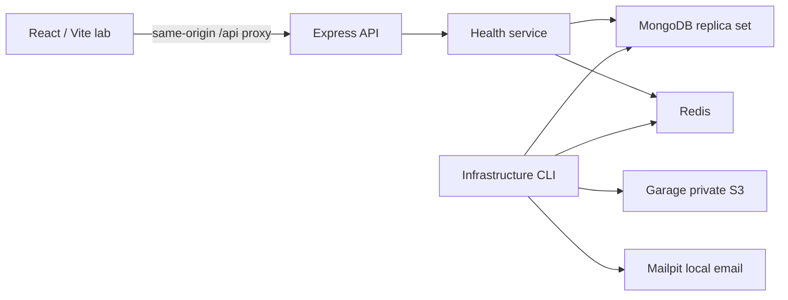

# Architecture

## Implemented in Phase 0

The pnpm monorepo shares runtime Zod response contracts, source-owned React components, and strict TypeScript configuration. Workspace imports use `workspace:*` and explicit package exports. Contracts compile before API/web checks or development startup. The frontend is a client-rendered Vite application, not a server-rendered framework.

The API separates process startup from application construction. Configuration is validated once, logging is structured and redacted, HTTP middleware owns request IDs/error formatting, and health routes receive infrastructure dependencies through an interface. Production TypeScript compiles to Node ESM. Graceful shutdown stops HTTP acceptance and closes connections, with a five-second deadline.

TanStack Query owns server responses; Zustand owns appearance and command-palette visibility only. Forms use React Hook Form and Zod. The design lab is loaded lazily only when development or an explicit build flag enables it.

Liveness is independent of database availability. Readiness checks MongoDB and Redis concurrently, with bounded connection/command timeouts and deduplicated in-flight probes. HTTP responses disclose only aggregate health, not credentials, hostnames, or individual dependency errors.

## Phase 1 public website

`/` serves the lazy-loaded marketing page in development and production. `/dev/design-system` remains development-only unless `VITE_ENABLE_DESIGN_LAB=true` explicitly enables it. Unknown routes render an accessible recovery page linking home. Native hash links navigate to product, feature, pricing, and FAQ sections and support refresh.

Marketing interactions use local React state: sample Board/List views, a design filter, task details, a guided tour, billing-period comparison, and selected-plan information. Shared Radix dialogs own focus containment, with explicit restoration to each opening control. The theme control is shared with the lab. Marketing CSS scopes shared heading selectors to prevent route-to-route style conflicts. Motion respects the user's reduced-motion preference.

No marketing endpoint, waitlist, account registration, payment collection, or product persistence is introduced. Prices and included features are explicitly proposed previews. The current backend and health contracts remain unchanged; future feature descriptions are labeled as plans. This phase needs no new dependencies or services.

## Future module conventions

Future feature modules organize routes/controllers, services, persistence, validation, and tests within their domain. Controllers authenticate and validate HTTP input; services authorize resources and enforce business rules; repositories perform explicitly scoped queries. Do not introduce unused business modules or database models in Phase 0.

Organizations are tenant and billing boundaries. Workspaces require explicit access for regular members; owners/admins retain organization administration rights. Project-level access is checked inside the authorized workspace. Guests receive explicit grants. Client-supplied IDs never establish membership or access.

Every tenant resource will carry `organizationId`; nested resources also carry their workspace/project identifiers. Resource lookup must use these verified parent relationships together, including cross-resource assignments and links. Permission tests must include a second organization and attempts to substitute foreign IDs. No tenant authorization is claimed as implemented in Phase 0 because no tenant resource endpoints exist.

Phase 2 implements Argon2id passwords, opaque MongoDB-backed session cookies, cookie security attributes, session-bound CSRF defense, exact Origin checks, and MongoDB-backed authentication abuse controls. Expired sessions are rejected by application logic before TTL deletion. Authentication does not imply organization or workspace membership.

Socket.IO is introduced in Phase 8 on the persistent Node API. Room subscription and event emission require the same membership and resource checks as HTTP. Redis adapters and a separate BullMQ worker are introduced only when realtime scaling and background jobs require them. Redis is infrastructure in Phase 0, not an authorization source.

AI and billing execute on the backend in their phases. AI receives authorized context and validated outputs; destructive or externally visible actions require confirmation. Billing remains test-mode until expressly re-scoped. All entitlement checks are server-side.

## Phase 2 identity boundary

The API auth module separates controllers, business services, and Mongoose repositories. It reuses the health adapter's bounded Mongo connection while leaving readiness's Redis requirement intact. Password hashing uses the exactly pinned stable `argon2@0.45.1` library; Node 24's native Argon2 API is still a release candidate, so the maintained password-oriented library avoids a custom PHC formatter. Hashing concurrency is bounded and encoded parameters are checked before verification.

Users and anonymous/authenticated sessions are real database records. Sign-in/registration rotate the session credential, and reset/change-password revoke sessions transactionally. Profiles and onboarding persist only personal details. Only a verified email can complete onboarding. No tenant or business-resource grants are created. Production configuration requires HTTPS origin and uses a Secure `__Host-` cookie; local HTTP uses the development cookie name.

The browser keeps session data in TanStack Query memory. Public marketing/lab routes do not fetch identity merely to render. Auth and protected routes distinguish initial loading, anonymous sessions, unavailable services, and authenticated users. Protected API operations always enforce identity independently of the route guard. Token links use fragments, are removed from the address bar, and require explicit form/button POST actions.

Local verification can use a separate Mongo replica set on 27018 with Mailpit on SMTP11025/HTTP18025, API4001, and frontend5174. These are task-owned processes and an isolated database, preserving existing services and credentials. The ordinary Compose environment remains the reproducible full-stack setup; the fixture is explicitly a local auth test convenience and does not verify Docker, Redis, or object storage.

## Deployment boundaries

Phase 0 is local-only. The eventual frontend can use static hosting; the API needs a persistent Node runtime supporting future realtime connections. Production uses Atlas, managed Redis, private S3-compatible storage, and a transactional email service. Garage/Mailpit and the single-node replica set are local development choices. Hosting/provider provisioning and deployment belong to Phase 14.
