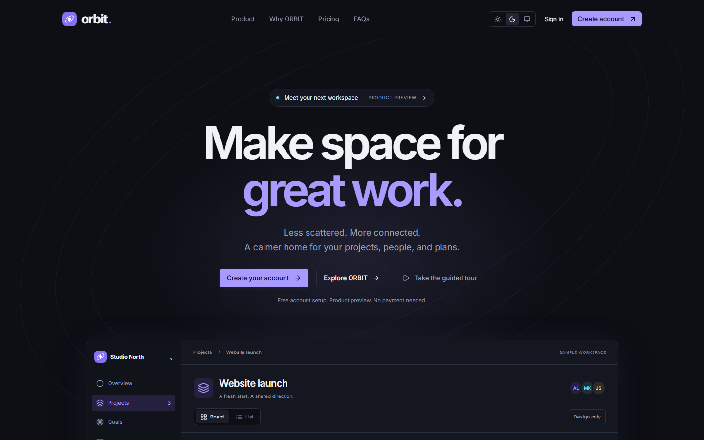
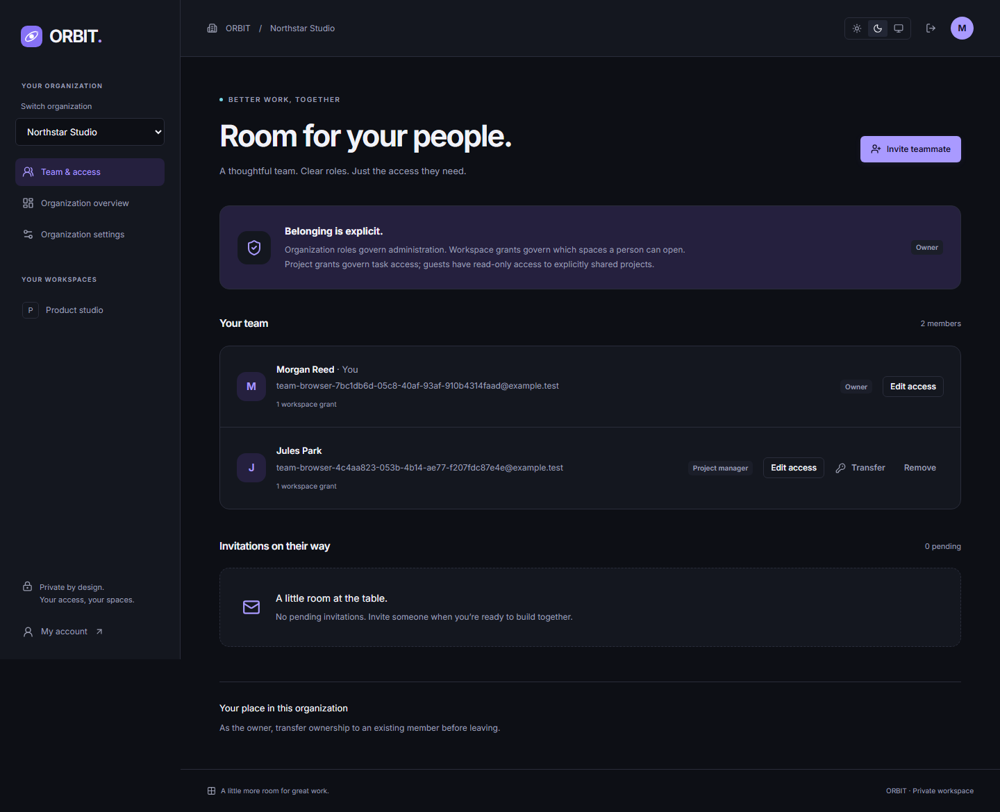

# ORBIT screenshot gallery

All captures come from the running local application. Marketing and lab content is explicitly illustrative. Account, workspace and collaboration captures use synthetic verification users and real local API/MongoDB/Mailpit workflows. These images contain no production credentials or business records.

Each theme was verified at 375px, 768px, and 1440px. The full set remains versioned under `docs/screenshots/`; the README shows selected views.

## Marketing website — Phase 1

| Viewport | Dark full page                                    | Light full page                                    |
| -------- | ------------------------------------------------- | -------------------------------------------------- |
| 375px    | [Screenshot](screenshots/marketing-dark-375.png)  | [Screenshot](screenshots/marketing-light-375.png)  |
| 768px    | [Screenshot](screenshots/marketing-dark-768.png)  | [Screenshot](screenshots/marketing-light-768.png)  |
| 1440px   | [Screenshot](screenshots/marketing-dark-1440.png) | [Screenshot](screenshots/marketing-light-1440.png) |

## Design system lab — Phase 0

| Viewport | Dark                                        | Light                                        |
| -------- | ------------------------------------------- | -------------------------------------------- |
| 375px    | [Screenshot](screenshots/lab-dark-375.png)  | [Screenshot](screenshots/lab-light-375.png)  |
| 768px    | [Screenshot](screenshots/lab-dark-768.png)  | [Screenshot](screenshots/lab-light-768.png)  |
| 1440px   | [Screenshot](screenshots/lab-dark-1440.png) | [Screenshot](screenshots/lab-light-1440.png) |

## Authentication — Phase 2

| Screen / viewport     | Dark                                                         | Light                                                         |
| --------------------- | ------------------------------------------------------------ | ------------------------------------------------------------- |
| Registration / 375px  | [Screenshot](screenshots/auth-register-dark-375.png)         | [Screenshot](screenshots/auth-register-light-375.png)         |
| Registration / 768px  | [Screenshot](screenshots/auth-register-dark-768.png)         | [Screenshot](screenshots/auth-register-light-768.png)         |
| Registration / 1440px | [Screenshot](screenshots/auth-register-dark-1440.png)        | [Screenshot](screenshots/auth-register-light-1440.png)        |
| Sign-in / 375px       | [Screenshot](screenshots/auth-login-dark-375.png)            | [Screenshot](screenshots/auth-login-light-375.png)            |
| Sign-in / 768px       | [Screenshot](screenshots/auth-login-dark-768.png)            | [Screenshot](screenshots/auth-login-light-768.png)            |
| Sign-in / 1440px      | [Screenshot](screenshots/auth-login-dark-1440.png)           | [Screenshot](screenshots/auth-login-light-1440.png)           |
| Recovery / 375px      | [Screenshot](screenshots/auth-forgot-password-dark-375.png)  | [Screenshot](screenshots/auth-forgot-password-light-375.png)  |
| Recovery / 768px      | [Screenshot](screenshots/auth-forgot-password-dark-768.png)  | [Screenshot](screenshots/auth-forgot-password-light-768.png)  |
| Recovery / 1440px     | [Screenshot](screenshots/auth-forgot-password-dark-1440.png) | [Screenshot](screenshots/auth-forgot-password-light-1440.png) |

## Verified onboarding and account — Phase 2

| Screen / viewport   | Dark                                               | Light                                               |
| ------------------- | -------------------------------------------------- | --------------------------------------------------- |
| Onboarding / 375px  | [Screenshot](screenshots/onboarding-dark-375.png)  | [Screenshot](screenshots/onboarding-light-375.png)  |
| Onboarding / 768px  | [Screenshot](screenshots/onboarding-dark-768.png)  | [Screenshot](screenshots/onboarding-light-768.png)  |
| Onboarding / 1440px | [Screenshot](screenshots/onboarding-dark-1440.png) | [Screenshot](screenshots/onboarding-light-1440.png) |
| Profile / 375px     | [Screenshot](screenshots/account-dark-375.png)     | [Screenshot](screenshots/account-light-375.png)     |
| Profile / 768px     | [Screenshot](screenshots/account-dark-768.png)     | [Screenshot](screenshots/account-light-768.png)     |
| Profile / 1440px    | [Screenshot](screenshots/account-dark-1440.png)    | [Screenshot](screenshots/account-light-1440.png)    |

- [Password/security tab, light desktop](screenshots/account-security-light-1440.png).
- [Session management, light desktop](screenshots/account-sessions-light-1440.png).

## Organizations and workspaces — Phase 3

| Screen / viewport              | Dark                                                          | Light                                                          |
| ------------------------------ | ------------------------------------------------------------- | -------------------------------------------------------------- |
| Empty organizations / 375px    | [Screenshot](screenshots/organizations-empty-dark-375.png)    | [Screenshot](screenshots/organizations-empty-light-375.png)    |
| Empty organizations / 768px    | [Screenshot](screenshots/organizations-empty-dark-768.png)    | [Screenshot](screenshots/organizations-empty-light-768.png)    |
| Empty organizations / 1440px   | [Screenshot](screenshots/organizations-empty-dark-1440.png)   | [Screenshot](screenshots/organizations-empty-light-1440.png)   |
| Organizations / 375px          | [Screenshot](screenshots/organizations-dark-375.png)          | [Screenshot](screenshots/organizations-light-375.png)          |
| Organizations / 768px          | [Screenshot](screenshots/organizations-dark-768.png)          | [Screenshot](screenshots/organizations-light-768.png)          |
| Organizations / 1440px         | [Screenshot](screenshots/organizations-dark-1440.png)         | [Screenshot](screenshots/organizations-light-1440.png)         |
| Organization overview / 375px  | [Screenshot](screenshots/organization-dark-375.png)           | [Screenshot](screenshots/organization-light-375.png)           |
| Organization overview / 768px  | [Screenshot](screenshots/organization-dark-768.png)           | [Screenshot](screenshots/organization-light-768.png)           |
| Organization overview / 1440px | [Screenshot](screenshots/organization-dark-1440.png)          | [Screenshot](screenshots/organization-light-1440.png)          |
| Workspace overview / 375px     | [Screenshot](screenshots/workspace-dark-375.png)              | [Screenshot](screenshots/workspace-light-375.png)              |
| Workspace overview / 768px     | [Screenshot](screenshots/workspace-dark-768.png)              | [Screenshot](screenshots/workspace-light-768.png)              |
| Workspace overview / 1440px    | [Screenshot](screenshots/workspace-dark-1440.png)             | [Screenshot](screenshots/workspace-light-1440.png)             |
| Organization settings / 375px  | [Screenshot](screenshots/organization-settings-dark-375.png)  | [Screenshot](screenshots/organization-settings-light-375.png)  |
| Organization settings / 768px  | [Screenshot](screenshots/organization-settings-dark-768.png)  | [Screenshot](screenshots/organization-settings-light-768.png)  |
| Organization settings / 1440px | [Screenshot](screenshots/organization-settings-dark-1440.png) | [Screenshot](screenshots/organization-settings-light-1440.png) |
| Workspace settings / 375px     | [Screenshot](screenshots/workspace-settings-dark-375.png)     | [Screenshot](screenshots/workspace-settings-light-375.png)     |
| Workspace settings / 768px     | [Screenshot](screenshots/workspace-settings-dark-768.png)     | [Screenshot](screenshots/workspace-settings-light-768.png)     |
| Workspace settings / 1440px    | [Screenshot](screenshots/workspace-settings-dark-1440.png)    | [Screenshot](screenshots/workspace-settings-light-1440.png)    |

See [phase progress](PHASE_PROGRESS.md) and [the Phase 3 verification report](PHASE3_REPORT.md) for executed results and deferred Docker acceptance.

## Teams and permissions — Phase 4

| View / width                | Dark                                                       | Light                                                       |
| --------------------------- | ---------------------------------------------------------- | ----------------------------------------------------------- |
| Empty team / 375px          | [Screenshot](screenshots/team-empty-dark-375.png)          | [Screenshot](screenshots/team-empty-light-375.png)          |
| Empty team / 768px          | [Screenshot](screenshots/team-empty-dark-768.png)          | [Screenshot](screenshots/team-empty-light-768.png)          |
| Empty team / 1440px         | [Screenshot](screenshots/team-empty-dark-1440.png)         | [Screenshot](screenshots/team-empty-light-1440.png)         |
| Pending invitation / 375px  | [Screenshot](screenshots/team-invited-dark-375.png)        | [Screenshot](screenshots/team-invited-light-375.png)        |
| Pending invitation / 768px  | [Screenshot](screenshots/team-invited-dark-768.png)        | [Screenshot](screenshots/team-invited-light-768.png)        |
| Pending invitation / 1440px | [Screenshot](screenshots/team-invited-dark-1440.png)       | [Screenshot](screenshots/team-invited-light-1440.png)       |
| Team roster / 375px         | [Screenshot](screenshots/team-members-dark-375.png)        | [Screenshot](screenshots/team-members-light-375.png)        |
| Team roster / 768px         | [Screenshot](screenshots/team-members-dark-768.png)        | [Screenshot](screenshots/team-members-light-768.png)        |
| Team roster / 1440px        | [Screenshot](screenshots/team-members-dark-1440.png)       | [Screenshot](screenshots/team-members-light-1440.png)       |
| Member permissions / 375px  | [Screenshot](screenshots/team-member-dark-375.png)         | [Screenshot](screenshots/team-member-light-375.png)         |
| Member permissions / 768px  | [Screenshot](screenshots/team-member-dark-768.png)         | [Screenshot](screenshots/team-member-light-768.png)         |
| Member permissions / 1440px | [Screenshot](screenshots/team-member-dark-1440.png)        | [Screenshot](screenshots/team-member-light-1440.png)        |
| Invitation sign-in / 375px  | [Screenshot](screenshots/invitation-signin-dark-375.png)   | [Screenshot](screenshots/invitation-signin-light-375.png)   |
| Invitation sign-in / 768px  | [Screenshot](screenshots/invitation-signin-dark-768.png)   | [Screenshot](screenshots/invitation-signin-light-768.png)   |
| Invitation sign-in / 1440px | [Screenshot](screenshots/invitation-signin-dark-1440.png)  | [Screenshot](screenshots/invitation-signin-light-1440.png)  |
| Accept invitation / 375px   | [Screenshot](screenshots/invitation-accept-dark-375.png)   | [Screenshot](screenshots/invitation-accept-light-375.png)   |
| Accept invitation / 768px   | [Screenshot](screenshots/invitation-accept-dark-768.png)   | [Screenshot](screenshots/invitation-accept-light-768.png)   |
| Accept invitation / 1440px  | [Screenshot](screenshots/invitation-accept-dark-1440.png)  | [Screenshot](screenshots/invitation-accept-light-1440.png)  |
| Invite dialog / 375px       | [Screenshot](screenshots/team-invite-dialog-dark-375.png)  | [Screenshot](screenshots/team-invite-dialog-light-375.png)  |
| Invite dialog / 768px       | [Screenshot](screenshots/team-invite-dialog-dark-768.png)  | [Screenshot](screenshots/team-invite-dialog-light-768.png)  |
| Invite dialog / 1440px      | [Screenshot](screenshots/team-invite-dialog-dark-1440.png) | [Screenshot](screenshots/team-invite-dialog-light-1440.png) |
| Access sheet / 375px        | [Screenshot](screenshots/team-access-sheet-dark-375.png)   | [Screenshot](screenshots/team-access-sheet-light-375.png)   |
| Access sheet / 768px        | [Screenshot](screenshots/team-access-sheet-dark-768.png)   | [Screenshot](screenshots/team-access-sheet-light-768.png)   |
| Access sheet / 1440px       | [Screenshot](screenshots/team-access-sheet-dark-1440.png)  | [Screenshot](screenshots/team-access-sheet-light-1440.png)  |

The invitation pages consume actual SMTP links and require a deliberate protected API action. The access sheet retains a member version for stale-edit protection. All 48 captures were audited in the real browser; see [the Phase 4 report](PHASE4_REPORT.md) for commands, results, fixes and limitations.

## Projects and tasks — Phase 5

Real API/database records under synthetic test users, cleaned after each browser scenario. Both themes and all three widths passed overflow and axe checks; overlays also passed keyboard containment, Escape and focus restoration.

| State                 | Dark 375 / 768 / 1440                                                                                                                                                   | Light 375 / 768 / 1440                                                                                                                                                     |
| --------------------- | ----------------------------------------------------------------------------------------------------------------------------------------------------------------------- | -------------------------------------------------------------------------------------------------------------------------------------------------------------------------- |
| projects-empty        | [375](screenshots/projects-empty-dark-375.png) / [768](screenshots/projects-empty-dark-768.png) / [1440](screenshots/projects-empty-dark-1440.png)                      | [375](screenshots/projects-empty-light-375.png) / [768](screenshots/projects-empty-light-768.png) / [1440](screenshots/projects-empty-light-1440.png)                      |
| projects-populated    | [375](screenshots/projects-populated-dark-375.png) / [768](screenshots/projects-populated-dark-768.png) / [1440](screenshots/projects-populated-dark-1440.png)          | [375](screenshots/projects-populated-light-375.png) / [768](screenshots/projects-populated-light-768.png) / [1440](screenshots/projects-populated-light-1440.png)          |
| project-create-dialog | [375](screenshots/project-create-dialog-dark-375.png) / [768](screenshots/project-create-dialog-dark-768.png) / [1440](screenshots/project-create-dialog-dark-1440.png) | [375](screenshots/project-create-dialog-light-375.png) / [768](screenshots/project-create-dialog-light-768.png) / [1440](screenshots/project-create-dialog-light-1440.png) |
| project-empty         | [375](screenshots/project-empty-dark-375.png) / [768](screenshots/project-empty-dark-768.png) / [1440](screenshots/project-empty-dark-1440.png)                         | [375](screenshots/project-empty-light-375.png) / [768](screenshots/project-empty-light-768.png) / [1440](screenshots/project-empty-light-1440.png)                         |
| project-populated     | [375](screenshots/project-populated-dark-375.png) / [768](screenshots/project-populated-dark-768.png) / [1440](screenshots/project-populated-dark-1440.png)             | [375](screenshots/project-populated-light-375.png) / [768](screenshots/project-populated-light-768.png) / [1440](screenshots/project-populated-light-1440.png)             |
| project-filtered      | [375](screenshots/project-filtered-dark-375.png) / [768](screenshots/project-filtered-dark-768.png) / [1440](screenshots/project-filtered-dark-1440.png)                | [375](screenshots/project-filtered-light-375.png) / [768](screenshots/project-filtered-light-768.png) / [1440](screenshots/project-filtered-light-1440.png)                |
| project-archived      | [375](screenshots/project-archived-dark-375.png) / [768](screenshots/project-archived-dark-768.png) / [1440](screenshots/project-archived-dark-1440.png)                | [375](screenshots/project-archived-light-375.png) / [768](screenshots/project-archived-light-768.png) / [1440](screenshots/project-archived-light-1440.png)                |
| task-detail           | [375](screenshots/task-detail-dark-375.png) / [768](screenshots/task-detail-dark-768.png) / [1440](screenshots/task-detail-dark-1440.png)                               | [375](screenshots/task-detail-light-375.png) / [768](screenshots/task-detail-light-768.png) / [1440](screenshots/task-detail-light-1440.png)                               |
| task-edit-sheet       | [375](screenshots/task-edit-sheet-dark-375.png) / [768](screenshots/task-edit-sheet-dark-768.png) / [1440](screenshots/task-edit-sheet-dark-1440.png)                   | [375](screenshots/task-edit-sheet-light-375.png) / [768](screenshots/task-edit-sheet-light-768.png) / [1440](screenshots/task-edit-sheet-light-1440.png)                   |

All 54 captures are retained. [Phase 5 verification report](PHASE5_REPORT.md) records commands, actual results, fixes and limits.

## Phase 6 work views

Actual browser/API/database fixtures, cleaned by unique IDs after verification. All 54 captures passed axe and page-overflow checks. Dialogs passed keyboard containment, Escape and focus restoration; moves also restore focus when a task leaves the current collection. Existing Phase 5 captures above remain historical evidence. [Verification report](PHASE6_REPORT.md).

| State                    | Dark 375 / 768 / 1440                                                                                                                                                            | Light 375 / 768 / 1440                                                                                                                                                              |
| ------------------------ | -------------------------------------------------------------------------------------------------------------------------------------------------------------------------------- | ----------------------------------------------------------------------------------------------------------------------------------------------------------------------------------- |
| work-list                | [375](screenshots/work-list-dark-375.png) / [768](screenshots/work-list-dark-768.png) / [1440](screenshots/work-list-dark-1440.png)                                              | [375](screenshots/work-list-light-375.png) / [768](screenshots/work-list-light-768.png) / [1440](screenshots/work-list-light-1440.png)                                              |
| work-list-grouped        | [375](screenshots/work-list-grouped-dark-375.png) / [768](screenshots/work-list-grouped-dark-768.png) / [1440](screenshots/work-list-grouped-dark-1440.png)                      | [375](screenshots/work-list-grouped-light-375.png) / [768](screenshots/work-list-grouped-light-768.png) / [1440](screenshots/work-list-grouped-light-1440.png)                      |
| work-kanban              | [375](screenshots/work-kanban-dark-375.png) / [768](screenshots/work-kanban-dark-768.png) / [1440](screenshots/work-kanban-dark-1440.png)                                        | [375](screenshots/work-kanban-light-375.png) / [768](screenshots/work-kanban-light-768.png) / [1440](screenshots/work-kanban-light-1440.png)                                        |
| work-table               | [375](screenshots/work-table-dark-375.png) / [768](screenshots/work-table-dark-768.png) / [1440](screenshots/work-table-dark-1440.png)                                           | [375](screenshots/work-table-light-375.png) / [768](screenshots/work-table-light-768.png) / [1440](screenshots/work-table-light-1440.png)                                           |
| work-calendar            | [375](screenshots/work-calendar-dark-375.png) / [768](screenshots/work-calendar-dark-768.png) / [1440](screenshots/work-calendar-dark-1440.png)                                  | [375](screenshots/work-calendar-light-375.png) / [768](screenshots/work-calendar-light-768.png) / [1440](screenshots/work-calendar-light-1440.png)                                  |
| work-undated             | [375](screenshots/work-undated-dark-375.png) / [768](screenshots/work-undated-dark-768.png) / [1440](screenshots/work-undated-dark-1440.png)                                     | [375](screenshots/work-undated-light-375.png) / [768](screenshots/work-undated-light-768.png) / [1440](screenshots/work-undated-light-1440.png)                                     |
| work-preferences-dialog  | [375](screenshots/work-preferences-dialog-dark-375.png) / [768](screenshots/work-preferences-dialog-dark-768.png) / [1440](screenshots/work-preferences-dialog-dark-1440.png)    | [375](screenshots/work-preferences-dialog-light-375.png) / [768](screenshots/work-preferences-dialog-light-768.png) / [1440](screenshots/work-preferences-dialog-light-1440.png)    |
| work-saved-filter-dialog | [375](screenshots/work-saved-filter-dialog-dark-375.png) / [768](screenshots/work-saved-filter-dialog-dark-768.png) / [1440](screenshots/work-saved-filter-dialog-dark-1440.png) | [375](screenshots/work-saved-filter-dialog-light-375.png) / [768](screenshots/work-saved-filter-dialog-light-768.png) / [1440](screenshots/work-saved-filter-dialog-light-1440.png) |
| work-move-dialog         | [375](screenshots/work-move-dialog-dark-375.png) / [768](screenshots/work-move-dialog-dark-768.png) / [1440](screenshots/work-move-dialog-dark-1440.png)                         | [375](screenshots/work-move-dialog-light-375.png) / [768](screenshots/work-move-dialog-light-768.png) / [1440](screenshots/work-move-dialog-light-1440.png)                         |

## Phase 7 delivery planning

The captures below use real API/MongoDB records under synthetic accounts, cleaned after verification. All eleven families are checked in both themes at 375/768/1440px, including page overflow and axe. Dialogs also check focus containment, Escape and restoration. [Verification report](PHASE7_REPORT.md).

| State                 | Dark 375 / 768 / 1440                                                                                                                                                   | Light 375 / 768 / 1440                                                                                                                                                     |
| --------------------- | ----------------------------------------------------------------------------------------------------------------------------------------------------------------------- | -------------------------------------------------------------------------------------------------------------------------------------------------------------------------- |
| planning-empty        | [375](screenshots/planning-empty-dark-375.png) / [768](screenshots/planning-empty-dark-768.png) / [1440](screenshots/planning-empty-dark-1440.png)                      | [375](screenshots/planning-empty-light-375.png) / [768](screenshots/planning-empty-light-768.png) / [1440](screenshots/planning-empty-light-1440.png)                      |
| plan-milestone-dialog | [375](screenshots/plan-milestone-dialog-dark-375.png) / [768](screenshots/plan-milestone-dialog-dark-768.png) / [1440](screenshots/plan-milestone-dialog-dark-1440.png) | [375](screenshots/plan-milestone-dialog-light-375.png) / [768](screenshots/plan-milestone-dialog-light-768.png) / [1440](screenshots/plan-milestone-dialog-light-1440.png) |
| plan-sprint-dialog    | [375](screenshots/plan-sprint-dialog-dark-375.png) / [768](screenshots/plan-sprint-dialog-dark-768.png) / [1440](screenshots/plan-sprint-dialog-dark-1440.png)          | [375](screenshots/plan-sprint-dialog-light-375.png) / [768](screenshots/plan-sprint-dialog-light-768.png) / [1440](screenshots/plan-sprint-dialog-light-1440.png)          |
| plan-timeline         | [375](screenshots/plan-timeline-dark-375.png) / [768](screenshots/plan-timeline-dark-768.png) / [1440](screenshots/plan-timeline-dark-1440.png)                         | [375](screenshots/plan-timeline-light-375.png) / [768](screenshots/plan-timeline-light-768.png) / [1440](screenshots/plan-timeline-light-1440.png)                         |
| plan-task-dialog      | [375](screenshots/plan-task-dialog-dark-375.png) / [768](screenshots/plan-task-dialog-dark-768.png) / [1440](screenshots/plan-task-dialog-dark-1440.png)                | [375](screenshots/plan-task-dialog-light-375.png) / [768](screenshots/plan-task-dialog-light-768.png) / [1440](screenshots/plan-task-dialog-light-1440.png)                |
| plan-milestones       | [375](screenshots/plan-milestones-dark-375.png) / [768](screenshots/plan-milestones-dark-768.png) / [1440](screenshots/plan-milestones-dark-1440.png)                   | [375](screenshots/plan-milestones-light-375.png) / [768](screenshots/plan-milestones-light-768.png) / [1440](screenshots/plan-milestones-light-1440.png)                   |
| plan-capacity-dialog  | [375](screenshots/plan-capacity-dialog-dark-375.png) / [768](screenshots/plan-capacity-dialog-dark-768.png) / [1440](screenshots/plan-capacity-dialog-dark-1440.png)    | [375](screenshots/plan-capacity-dialog-light-375.png) / [768](screenshots/plan-capacity-dialog-light-768.png) / [1440](screenshots/plan-capacity-dialog-light-1440.png)    |
| plan-workload         | [375](screenshots/plan-workload-dark-375.png) / [768](screenshots/plan-workload-dark-768.png) / [1440](screenshots/plan-workload-dark-1440.png)                         | [375](screenshots/plan-workload-light-375.png) / [768](screenshots/plan-workload-light-768.png) / [1440](screenshots/plan-workload-light-1440.png)                         |
| plan-sprints          | [375](screenshots/plan-sprints-dark-375.png) / [768](screenshots/plan-sprints-dark-768.png) / [1440](screenshots/plan-sprints-dark-1440.png)                            | [375](screenshots/plan-sprints-light-375.png) / [768](screenshots/plan-sprints-light-768.png) / [1440](screenshots/plan-sprints-light-1440.png)                            |
| plan-complete-dialog  | [375](screenshots/plan-complete-dialog-dark-375.png) / [768](screenshots/plan-complete-dialog-dark-768.png) / [1440](screenshots/plan-complete-dialog-dark-1440.png)    | [375](screenshots/plan-complete-dialog-light-375.png) / [768](screenshots/plan-complete-dialog-light-768.png) / [1440](screenshots/plan-complete-dialog-light-1440.png)    |
| plan-delivery         | [375](screenshots/plan-delivery-dark-375.png) / [768](screenshots/plan-delivery-dark-768.png) / [1440](screenshots/plan-delivery-dark-1440.png)                         | [375](screenshots/plan-delivery-light-375.png) / [768](screenshots/plan-delivery-light-768.png) / [1440](screenshots/plan-delivery-light-1440.png)                         |

## Phase 8 collaboration

Ten page/dialog families use real API/MongoDB records and two authorized browser sessions under synthetic users. Each family passed dark/light at 375/768/1440, overflow and axe checks; edit/remove dialogs also check keyboard containment, Escape and restored focus. [Verification report](PHASE8_REPORT.md).

| State                          | Dark 375 / 768 / 1440                                                                                                                                                                              | Light 375 / 768 / 1440                                                                                                                                                                                |
| ------------------------------ | -------------------------------------------------------------------------------------------------------------------------------------------------------------------------------------------------- | ----------------------------------------------------------------------------------------------------------------------------------------------------------------------------------------------------- |
| collaboration-archived         | [375](screenshots/collaboration-archived-dark-375.png) / [768](screenshots/collaboration-archived-dark-768.png) / [1440](screenshots/collaboration-archived-dark-1440.png)                         | [375](screenshots/collaboration-archived-light-375.png) / [768](screenshots/collaboration-archived-light-768.png) / [1440](screenshots/collaboration-archived-light-1440.png)                         |
| collaboration-comments         | [375](screenshots/collaboration-comments-dark-375.png) / [768](screenshots/collaboration-comments-dark-768.png) / [1440](screenshots/collaboration-comments-dark-1440.png)                         | [375](screenshots/collaboration-comments-light-375.png) / [768](screenshots/collaboration-comments-light-768.png) / [1440](screenshots/collaboration-comments-light-1440.png)                         |
| collaboration-comments-empty   | [375](screenshots/collaboration-comments-empty-dark-375.png) / [768](screenshots/collaboration-comments-empty-dark-768.png) / [1440](screenshots/collaboration-comments-empty-dark-1440.png)       | [375](screenshots/collaboration-comments-empty-light-375.png) / [768](screenshots/collaboration-comments-empty-light-768.png) / [1440](screenshots/collaboration-comments-empty-light-1440.png)       |
| collaboration-discussion       | [375](screenshots/collaboration-discussion-dark-375.png) / [768](screenshots/collaboration-discussion-dark-768.png) / [1440](screenshots/collaboration-discussion-dark-1440.png)                   | [375](screenshots/collaboration-discussion-light-375.png) / [768](screenshots/collaboration-discussion-light-768.png) / [1440](screenshots/collaboration-discussion-light-1440.png)                   |
| collaboration-discussion-empty | [375](screenshots/collaboration-discussion-empty-dark-375.png) / [768](screenshots/collaboration-discussion-empty-dark-768.png) / [1440](screenshots/collaboration-discussion-empty-dark-1440.png) | [375](screenshots/collaboration-discussion-empty-light-375.png) / [768](screenshots/collaboration-discussion-empty-light-768.png) / [1440](screenshots/collaboration-discussion-empty-light-1440.png) |
| collaboration-edit-dialog      | [375](screenshots/collaboration-edit-dialog-dark-375.png) / [768](screenshots/collaboration-edit-dialog-dark-768.png) / [1440](screenshots/collaboration-edit-dialog-dark-1440.png)                | [375](screenshots/collaboration-edit-dialog-light-375.png) / [768](screenshots/collaboration-edit-dialog-light-768.png) / [1440](screenshots/collaboration-edit-dialog-light-1440.png)                |
| collaboration-inbox            | [375](screenshots/collaboration-inbox-dark-375.png) / [768](screenshots/collaboration-inbox-dark-768.png) / [1440](screenshots/collaboration-inbox-dark-1440.png)                                  | [375](screenshots/collaboration-inbox-light-375.png) / [768](screenshots/collaboration-inbox-light-768.png) / [1440](screenshots/collaboration-inbox-light-1440.png)                                  |
| collaboration-inbox-empty      | [375](screenshots/collaboration-inbox-empty-dark-375.png) / [768](screenshots/collaboration-inbox-empty-dark-768.png) / [1440](screenshots/collaboration-inbox-empty-dark-1440.png)                | [375](screenshots/collaboration-inbox-empty-light-375.png) / [768](screenshots/collaboration-inbox-empty-light-768.png) / [1440](screenshots/collaboration-inbox-empty-light-1440.png)                |
| collaboration-readonly         | [375](screenshots/collaboration-readonly-dark-375.png) / [768](screenshots/collaboration-readonly-dark-768.png) / [1440](screenshots/collaboration-readonly-dark-1440.png)                         | [375](screenshots/collaboration-readonly-light-375.png) / [768](screenshots/collaboration-readonly-light-768.png) / [1440](screenshots/collaboration-readonly-light-1440.png)                         |
| collaboration-remove-dialog    | [375](screenshots/collaboration-remove-dialog-dark-375.png) / [768](screenshots/collaboration-remove-dialog-dark-768.png) / [1440](screenshots/collaboration-remove-dialog-dark-1440.png)          | [375](screenshots/collaboration-remove-dialog-light-375.png) / [768](screenshots/collaboration-remove-dialog-light-768.png) / [1440](screenshots/collaboration-remove-dialog-light-1440.png)          |

## Phase 9 documents and files

72 captures across 12 page/dialog states, dark/light and375/768/1440. Actual synthetic documents and private bytes use the local API, MongoDB and disk storage. Keyboard containment/restoration, overflow and axe are checked alongside these captures.

| State          | Dark375                                                       | Dark768                                                       | Dark1440                                                        | Light375                                                        | Light768                                                        | Light1440                                                         |
| -------------- | ------------------------------------------------------------- | ------------------------------------------------------------- | --------------------------------------------------------------- | --------------------------------------------------------------- | --------------------------------------------------------------- | ----------------------------------------------------------------- |
| archived       | [dark 375](screenshots/documents-archived-dark-375.png)       | [dark 768](screenshots/documents-archived-dark-768.png)       | [dark 1440](screenshots/documents-archived-dark-1440.png)       | [light 375](screenshots/documents-archived-light-375.png)       | [light 768](screenshots/documents-archived-light-768.png)       | [light 1440](screenshots/documents-archived-light-1440.png)       |
| attachment     | [dark 375](screenshots/documents-attachment-dark-375.png)     | [dark 768](screenshots/documents-attachment-dark-768.png)     | [dark 1440](screenshots/documents-attachment-dark-1440.png)     | [light 375](screenshots/documents-attachment-light-375.png)     | [light 768](screenshots/documents-attachment-light-768.png)     | [light 1440](screenshots/documents-attachment-light-1440.png)     |
| create         | [dark 375](screenshots/documents-create-dark-375.png)         | [dark 768](screenshots/documents-create-dark-768.png)         | [dark 1440](screenshots/documents-create-dark-1440.png)         | [light 375](screenshots/documents-create-light-375.png)         | [light 768](screenshots/documents-create-light-768.png)         | [light 1440](screenshots/documents-create-light-1440.png)         |
| edit           | [dark 375](screenshots/documents-edit-dark-375.png)           | [dark 768](screenshots/documents-edit-dark-768.png)           | [dark 1440](screenshots/documents-edit-dark-1440.png)           | [light 375](screenshots/documents-edit-light-375.png)           | [light 768](screenshots/documents-edit-light-768.png)           | [light 1440](screenshots/documents-edit-light-1440.png)           |
| empty          | [dark 375](screenshots/documents-empty-dark-375.png)          | [dark 768](screenshots/documents-empty-dark-768.png)          | [dark 1440](screenshots/documents-empty-dark-1440.png)          | [light 375](screenshots/documents-empty-light-375.png)          | [light 768](screenshots/documents-empty-light-768.png)          | [light 1440](screenshots/documents-empty-light-1440.png)          |
| files filtered | [dark 375](screenshots/documents-files-filtered-dark-375.png) | [dark 768](screenshots/documents-files-filtered-dark-768.png) | [dark 1440](screenshots/documents-files-filtered-dark-1440.png) | [light 375](screenshots/documents-files-filtered-light-375.png) | [light 768](screenshots/documents-files-filtered-light-768.png) | [light 1440](screenshots/documents-files-filtered-light-1440.png) |
| history        | [dark 375](screenshots/documents-history-dark-375.png)        | [dark 768](screenshots/documents-history-dark-768.png)        | [dark 1440](screenshots/documents-history-dark-1440.png)        | [light 375](screenshots/documents-history-light-375.png)        | [light 768](screenshots/documents-history-light-768.png)        | [light 1440](screenshots/documents-history-light-1440.png)        |
| pdf preview    | [dark 375](screenshots/documents-pdf-preview-dark-375.png)    | [dark 768](screenshots/documents-pdf-preview-dark-768.png)    | [dark 1440](screenshots/documents-pdf-preview-dark-1440.png)    | [light 375](screenshots/documents-pdf-preview-light-375.png)    | [light 768](screenshots/documents-pdf-preview-light-768.png)    | [light 1440](screenshots/documents-pdf-preview-light-1440.png)    |
| reading        | [dark 375](screenshots/documents-reading-dark-375.png)        | [dark 768](screenshots/documents-reading-dark-768.png)        | [dark 1440](screenshots/documents-reading-dark-1440.png)        | [light 375](screenshots/documents-reading-light-375.png)        | [light 768](screenshots/documents-reading-light-768.png)        | [light 1440](screenshots/documents-reading-light-1440.png)        |
| remove file    | [dark 375](screenshots/documents-remove-file-dark-375.png)    | [dark 768](screenshots/documents-remove-file-dark-768.png)    | [dark 1440](screenshots/documents-remove-file-dark-1440.png)    | [light 375](screenshots/documents-remove-file-light-375.png)    | [light 768](screenshots/documents-remove-file-light-768.png)    | [light 1440](screenshots/documents-remove-file-light-1440.png)    |
| rename         | [dark 375](screenshots/documents-rename-dark-375.png)         | [dark 768](screenshots/documents-rename-dark-768.png)         | [dark 1440](screenshots/documents-rename-dark-1440.png)         | [light 375](screenshots/documents-rename-light-375.png)         | [light 768](screenshots/documents-rename-light-768.png)         | [light 1440](screenshots/documents-rename-light-1440.png)         |
| text preview   | [dark 375](screenshots/documents-text-preview-dark-375.png)   | [dark 768](screenshots/documents-text-preview-dark-768.png)   | [dark 1440](screenshots/documents-text-preview-dark-1440.png)   | [light 375](screenshots/documents-text-preview-light-375.png)   | [light 768](screenshots/documents-text-preview-light-768.png)   | [light 1440](screenshots/documents-text-preview-light-1440.png)   |
